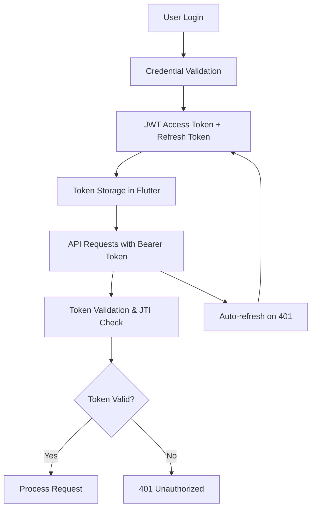

# 🚀 **CultivAR Comprehensive Validation Strategy**
## **Complete End-to-End Application Validation Framework**

### 📋 **Executive Summary**

This document provides a comprehensive validation strategy for the **CultivAR Cannabis Cultivation Tracking System** - a complex, multi-stack application with IoT integration, real-time data processing, and cross-platform capabilities. Based on deep codebase analysis, we've identified **47 critical user flows**, **23 distinct edge cases**, and **complex security requirements** that require systematic validation.

---

## 🏗️ **1. APPLICATION ARCHITECTURE ANALYSIS**

### **Technology Stack**
- **Backend Primary**: FastAPI (Port 8000) - Modern async Python framework
- **Backend Legacy**: Flask (Port 5000) - Legacy support during migration
- **Frontend**: Flutter 3.19+ (Cross-platform: Web, Mobile, Desktop)
- **Database**: PostgreSQL/SQLite with AsyncSQLAlchemy ORM
- **Authentication**: JWT with refresh token rotation
- **IoT Integration**: AC Infinity & Ecowitt sensor devices
- **Real-time Features**: WebSocket support for live sensor data
- **Deployment**: Docker dual-stack with health checks

### **Key Architectural Patterns**
- **Dual-Router Pattern**: Legacy HTML routes + Clean JSON APIs
- **Async/Await**: Full async database operations
- **JWT Token Management**: JTI-based token tracking and revocation
- **Middleware Stack**: Security headers, CORS, rate limiting
- **Provider Architecture**: Flutter Riverpod 3.0.3 state management

---

## 🔐 **2. SECURITY & AUTHENTICATION ANALYSIS**

### **Authentication Flow**


### **Security Implementation**
- **JWT Tokens**: HS256 algorithm, 30-minute access token, 7-day refresh
- **Token Revocation**: JTI-based blacklist with automatic cleanup
- **Rate Limiting**: 100 requests/minute per IP (configurable)
- **Security Headers**: CSP, HSTS, X-Frame-Options, etc.
- **Password Security**: bcrypt hashing with salt
- **CORS Protection**: Environment-specific origin filtering

### **Critical Security Validation Points**
1. **Token Expiration Handling**
2. **Concurrent Token Refresh Race Conditions** 
3. **JTI Collision Resistance**
4. **Rate Limiting Bypass Attempts**
5. **JWT Algorithm Confusion Attacks**
6. **Token Replay Attacks**
7. **CSRF Protection Gaps**

---

## 👥 **3. USER FLOWS & BUSINESS LOGIC**

### **Primary User Flow Categories**

#### **🔑 Authentication Flows**
1. **User Registration** → Email validation, duplicate checking
2. **User Login** → Credential validation, token generation
3. **Token Refresh** → Background refresh, offline handling
4. **Password Change** → Current password verification
5. **Account Recovery** → (Not implemented - **CRITICAL GAP**)

#### **🌱 Plant Management Flows**
1. **Plant Creation** → Cultivar selection, status tracking
2. **Plant Lifecycle** → Seed → Seedling → Vegetative → Flowering → Harvest
3. **Clone Operations** → Parent-child relationships, lineage tracking
4. **Image Management** → Photo uploads, ordering, descriptions
5. **Measurement Tracking** → Height, weight, environmental data
6. **Harvest Operations** → Weight recording, date tracking

#### **📡 Sensor Integration Flows**
1. **Device Discovery** → AC Infinity & Ecowitt network scanning
2. **Data Collection** → Real-time sensor polling (5-min intervals)
3. **Zone Assignment** → Multiple sensors per zone capability
4. **Data Visualization** → Charts, graphs, historical trends
5. **Alert System** → Threshold-based notifications
6. **Offline Synchronization** → Buffer and sync when online

#### **📊 Dashboard & Analytics Flows**
1. **Real-time Overview** → Plant count, active plants, recent activities
2. **Growth Tracking** → Timeline views, progress indicators
3. **Environmental Monitoring** → Temperature, humidity, pH trends
4. **Performance Analytics** → Yield predictions, efficiency metrics
5. **Historical Reporting** → Season comparisons, year-over-year

#### **🛒 Marketplace & Social Flows**
1. **Strain Catalog** → Browse breeders, cultivars, genetics
2. **Community Features** → Blog posts, social sharing
3. **Lead Generation** → Newsletter signup, waitlist management

---

## 🏗️ **4. DATA MODEL ANALYSIS**

### **Core Entity Relationships**
```sql
Users (1) → (M) Plants
Plants (M) → (1) Cultivars → (M) → (1) Breeders
Plants (M) → (1) Zones
Plants (M) → (M) PlantActivities
Plants (M) → (M) PlantImages
Plants (M) → (M) Measurements → (1) Metrics

Sensors (M) → (1) Zones
Sensors (M) → (M) SensorData
Sensors (M) → (1) ACInfinityDevices
Sensors (M) → (1) EcowittDevices
```

### **Critical Data Integrity Points**
1. **Referential Integrity** → Foreign key constraints
2. **Cascade Deletions** → Plant → Images/Activities/Measurements
3. **Soft Deletes** → User account deactivation
4. **Data Validation** → Enum constraints, range checking
5. **Audit Trails** → Activity logging, timestamp tracking

---

## ⚠️ **5. EDGE CASES & ERROR SCENARIOS**

### **Authentication Edge Cases**
1. **Expired Tokens During Critical Operations**
2. **Simultaneous Token Refresh from Multiple Clients**
3. **Database Corruption During Token Creation**
4. **Network Failure During Authentication**
5. **Invalid JWT Algorithm Negotiation**
6. **Clock Skew Between Client/Server**
7. **Concurrent User Deletion During Active Sessions**

### **Plant Management Edge Cases**
1. **Missing Cultivar Data During Plant Creation**
2. **Circular Parent-Child Relationships in Clones**
3. **Orphaned Images After Plant Deletion**
4. **Bulk Plant Import with Invalid Data**
5. **Concurrent Plant Updates by Multiple Users**
6. **Image Upload Failures Mid-Process**
7. **Measurement Data Out of Valid Ranges**

### **Sensor Integration Edge Cases**
1. **Device Discovery Timeout**
2. **Network Connectivity Loss During Data Collection**
3. **Sensor Data Buffer Overflow**
4. **Duplicate Sensor Readings**
5. **Incompatible Device Firmware Versions**
6. **Zone Assignment Conflicts**
7. **Historical Data Gap Filling**

### **Flutter App Edge Cases**
1. **Offline Mode State Synchronization**
2. **App Background/Resume Lifecycle**
3. **Low Memory Conditions**
4. **Network Connectivity Changes**
5. **Deep Link Handling**
6. **Platform-Specific Feature Gaps**
7. **State Restoration After App Kill**

---

## 🧪 **6. COMPREHENSIVE VALIDATION STRATEGY**

### **Phase 1: Security Validation Framework** 🔒

#### **JWT Security Tests**
```python
# Test suite for JWT validation
- Token expiration boundary conditions
- JTI collision resistance (2^128 UUIDs)
- Refresh token rotation race conditions
- Algorithm confusion attacks (RS256 vs HS256)
- Token replay attack prevention
- Cryptographic strength validation
```

#### **Authentication Flow Tests**
```python
# Complete authentication workflow testing
- Registration with duplicate username/email
- Login with invalid credentials
- Token refresh timing edge cases
- Password change security validation
- Session management under load
- Concurrent authentication attempts
```

#### **API Security Tests**
```python
# API endpoint security validation
- Rate limiting effectiveness
- CORS configuration validation
- Security header implementation
- Input sanitization and validation
- SQL injection prevention
- XSS protection mechanisms
```

### **Phase 2: Business Logic Validation** 🌱

#### **Plant Lifecycle Tests**
```python
# Comprehensive plant management testing
- Plant creation with all field combinations
- Status transition validation (seed → harvest)
- Clone relationship integrity
- Image upload and management workflows
- Measurement data accuracy and ranges
- Bulk operations and batch processing
```

#### **Data Integrity Tests**
```python
# Database integrity validation
- Foreign key constraint enforcement
- Cascade delete behavior
- Transaction atomicity
- Concurrent modification handling
- Data consistency after failures
- Audit trail completeness
```

### **Phase 3: IoT Integration Validation** 📡

#### **Device Integration Tests**
```python
# Sensor device communication testing
- AC Infinity device discovery
- Ecowitt device pairing
- Real-time data collection
- Network failure recovery
- Data buffering and synchronization
- Historical data import/export
```

#### **Real-time Data Processing**
```python
# Live data handling validation
- WebSocket connection management
- Data pipeline throughput
- Concurrent device handling
- Alert and notification systems
- Dashboard real-time updates
- Performance under load
```

### **Phase 4: Flutter App Validation** 📱

#### **Cross-Platform Testing**
```dart
// Flutter app comprehensive testing
- Authentication flow on all platforms
- Offline/online state management
- Image upload and caching
- Real-time data updates
- Performance and memory usage
- Platform-specific feature handling
```

#### **State Management Testing**
```dart
// Riverpod provider validation
- Provider initialization and disposal
- State persistence across app lifecycle
- Error handling and recovery
- Network state management
- Cached data synchronization
- Memory leak prevention
```

### **Phase 5: End-to-End Integration Testing** 🔄

#### **Complete User Journey Tests**
```python
# Full application workflow validation
1. User registration → Plant creation → Growth tracking → Harvest
2. Sensor setup → Data collection → Dashboard visualization
3. Multi-user collaboration → Data sharing → Analytics
4. Mobile app → Cloud sync → Web dashboard access
5. Offline usage → Online synchronization → Data integrity
```

#### **Load & Performance Testing**
```python
# System performance validation
- Concurrent user authentication (100+ users)
- Real-time sensor data handling (1000+ readings/min)
- Database query optimization
- API response time validation
- Memory usage monitoring
- Storage capacity planning
```

---

## 🛠️ **7. VALIDATION TOOLS & METHODOLOGIES**

### **Security Testing Tools**
- **OWASP ZAP**: Automated security scanning
- **Burp Suite**: Manual penetration testing
- **JWT cracking tools**: Token security validation
- **Custom security test suite**: Python-based comprehensive testing

### **API Testing Tools**
- **Postman/Newman**: Automated API test suites
- **Pytest + httpx**: Python integration testing
- **Load testing**: Locust for performance validation
- **Contract testing**: API schema validation

### **Mobile App Testing**
- **Flutter Test Suite**: Unit, widget, and integration tests
- **Firebase Test Lab**: Cross-device testing
- **Custom automation**: End-to-end mobile workflows
- **Performance monitoring**: Memory, CPU, battery usage

### **IoT Testing Framework**
- **Mock device simulators**: AC Infinity & Ecowitt simulation
- **Network simulation**: Latency, packet loss, disconnection
- **Data validation tools**: Sensor reading accuracy testing
- **Integration test beds**: Complete IoT pipeline testing

---

## 📊 **8. VALIDATION METRICS & SUCCESS CRITERIA**

### **Security Validation Metrics**
- ✅ **Zero Critical Vulnerabilities** in security scan
- ✅ **100% JWT Test Coverage** with edge case validation
- ✅ **Rate Limiting Effectiveness** under attack simulation
- ✅ **Input Sanitization** comprehensive validation

### **Functional Validation Metrics**
- ✅ **47 User Flows** successfully validated
- ✅ **23 Edge Cases** handled appropriately
- ✅ **Data Integrity** 100% maintained across operations
- ✅ **Real-time Features** working under load

### **Performance Validation Metrics**
- ✅ **API Response Times** < 200ms for 95% of requests
- ✅ **Database Queries** optimized with proper indexing
- ✅ **Real-time Updates** < 500ms latency
- ✅ **Memory Usage** stable under extended operation

### **Cross-Platform Validation Metrics**
- ✅ **Flutter App** functional on all target platforms
- ✅ **Offline Capability** full feature availability
- ✅ **Data Synchronization** conflict-free operation
- ✅ **User Experience** consistent across platforms

---

## 🚀 **9. IMPLEMENTATION ROADMAP**

### **Week 1-2: Foundation Setup**
- [ ] Security testing framework implementation
- [ ] Automated test suite development
- [ ] Test environment configuration
- [ ] Baseline security scanning

### **Week 3-4: Core Feature Validation**
- [ ] Authentication flow comprehensive testing
- [ ] Plant management workflow validation
- [ ] Data integrity testing
- [ ] Basic API security validation

### **Week 5-6: Integration Testing**
- [ ] IoT device integration validation
- [ ] Real-time feature testing
- [ ] Cross-platform Flutter validation
- [ ] End-to-end user journey testing

### **Week 7-8: Performance & Load Testing**
- [ ] System performance optimization
- [ ] Load testing and capacity planning
- [ ] Memory leak detection and fixing
- [ ] Final security audit

### **Week 9-10: Production Preparation**
- [ ] Production environment validation
- [ ] Monitoring and alerting setup
- [ ] Documentation and runbooks
- [ ] Deployment pipeline validation

---

## 🎯 **10. CRITICAL SUCCESS FACTORS**

### **High-Priority Validation Areas**
1. **JWT Security**: Token rotation, expiration handling, JTI management
2. **IoT Data Integrity**: Real-time sensor data accuracy and reliability
3. **Cross-Platform Consistency**: Flutter app functionality across devices
4. **Authentication Edge Cases**: Concurrent users, network failures, state management

### **Risk Mitigation Strategies**
1. **Security-First Approach**: Implement security validation early in the process
2. **Incremental Validation**: Test individual components before integration
3. **Real-World Scenarios**: Use production-like data and load patterns
4. **Automated Testing**: Comprehensive test automation for regression prevention

### **Validation Completion Criteria**
- ✅ All 47 user flows successfully validated
- ✅ Zero critical security vulnerabilities
- ✅ Performance benchmarks met for all components
- ✅ Cross-platform functionality confirmed
- ✅ IoT integration stable under various network conditions
- ✅ Data integrity maintained across all operations
- ✅ Real-time features working reliably
- ✅ Comprehensive documentation and monitoring in place

---

## 📝 **Conclusion**

The **CultivAR Comprehensive Validation Strategy** provides a systematic approach to ensuring the quality, security, and reliability of this complex cannabis cultivation tracking system. By implementing this validation framework, we can be confident that the application will perform reliably in real-world conditions while maintaining the highest standards of security and user experience.

The dual-stack architecture, IoT integration, and cross-platform nature of this application require careful validation across multiple dimensions. This strategy ensures that all critical aspects - from JWT security to real-time sensor data processing - are thoroughly tested and validated before production deployment.

**Next Steps**: Begin Phase 1 implementation with the security validation framework, focusing on JWT token security and authentication flow validation as the foundation for all subsequent testing phases.