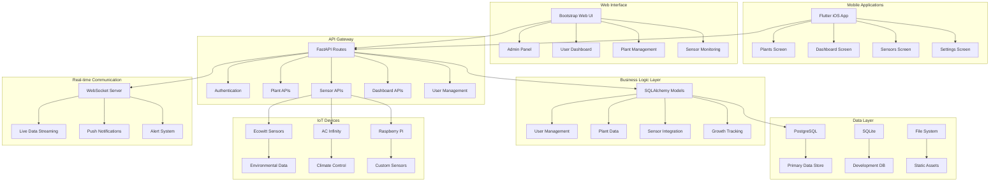

# CultivAREmergant: Comprehensive Technology Stack & Roadmap Report

**Generated:** November 18, 2025  
**Repository:** CultivAREmergant  
**Analysis Scope:** Complete codebase and documentation review  

## Executive Summary

CultivAREmergant is a sophisticated dual-stack application combining FastAPI/Flask backend with Flutter mobile frontend, specifically designed for cannabis cultivation management. The platform integrates IoT sensors, real-time data processing, and comprehensive grow tracking with both web and mobile interfaces.

---

## Current Technology Stack

### Backend Architecture

#### Core Framework & Language
- **Python 3.9+** - Primary backend language
- **FastAPI** - Modern, high-performance REST API framework
- **Flask** - Traditional web framework for legacy compatibility
- **SQLAlchemy 2.0.23** - SQL toolkit and ORM
- **Alembic** - Database migration management

#### Database Systems
- **SQLite** - Default development database
- **PostgreSQL** - Production-ready relational database
- **Alembic Migrations** - Database schema versioning

#### Authentication & Security
- **JWT (JSON Web Tokens)** - Stateless authentication
- **Flask-Login 0.6.2** - Session management
- **Flask-Session 0.5.0** - Server-side session storage
- **bcrypt 4.0.1** - Password hashing
- **CSRF Protection** - Cross-site request forgery prevention

#### API Architecture
- **RESTful APIs** - Resource-based endpoint design
- **Pydantic** - Data validation and serialization
- **OpenAPI/Swagger** - Automatic API documentation
- **WebSocket Support** - Real-time communication capabilities

#### Data Processing & Storage
- **Pillow 10.1.0** - Image processing and manipulation
- **requests 2.31.0** - HTTP client for external APIs
- **Image Storage** - File system-based asset management

### Frontend Architecture

#### Mobile Application (Flutter)
- **Flutter 3.19+** - Cross-platform mobile framework
- **Dart** - Programming language for Flutter
- **Riverpod** - State management and dependency injection
- **GoRouter** - Declarative routing and navigation
- **Dio** - Advanced HTTP client with interceptors

#### Web Interface (Legacy)
- **Jinja2 3.1.2** - Template engine
- **Bootstrap 5** - Responsive CSS framework
- **JavaScript Libraries**:
  - jQuery - DOM manipulation
  - Chart.js - Data visualization
  - FontAwesome - Icon library
  - Moment.js - Date/time handling

### IoT & Sensor Integration

#### Supported Device Manufacturers
- **Ecowitt** - Environmental monitoring sensors
  - Temperature and humidity sensors
  - Air pressure monitoring
  - Soil moisture detection
  - Light intensity measurement
- **AC Infinity** - Climate control equipment
  - Ventilation systems
  - Environmental controllers

#### Sensor Data Management
- **Real-time Data Processing** - WebSocket-based streaming
- **Historical Data Storage** - Time-series sensor data
- **Alert System** - Environmental condition notifications

### Development & DevOps

#### Containerization
- **Docker** - Application containerization
- **Docker Compose** - Multi-service orchestration
- **nginx** - Reverse proxy and static file serving

#### Development Tools
- **Testing Framework**: pytest
- **Code Quality**: flake8, black, pylint
- **Version Control**: Git
- **Build Tools**: Make, setup scripts

#### Production Infrastructure
- **gunicorn 21.2.0** - WSGI server for production
- **nginx** - Web server and load balancer
- **Static File Serving** - Optimized asset delivery

### Testing Infrastructure

#### Backend Testing
- **Unit Tests** - Component-level testing with pytest
- **Integration Tests** - API endpoint validation
- **Security Tests** - XSS and injection protection
- **Authentication Tests** - Login flow validation

#### Flutter Testing (Planned)
- **Unit Tests** - Business logic testing
- **Widget Tests** - UI component validation
- **Integration Tests** - End-to-end user flows
- **Golden Tests** - Visual regression prevention

---

## Planned Technologies & Roadmap

### Phase 1: Flutter Migration (In Progress)

#### Current Status: Phase 1 - Foundation
- **Authentication System** ✅ Implemented
- **Core Infrastructure** ✅ Completed
- **API Integration** ✅ In Progress
- **State Management** 🔄 Riverpod implementation
- **UI Components** 🔄 Glass morphism design system

#### Technology Enhancements
- **Freezed** - Immutable data classes and union types
- **json_serializable** - Automatic JSON serialization
- **build_runner** - Code generation for models and providers
- **riverpod_annotation** - Enhanced provider definitions

#### Testing Strategy
- **80% Unit Test Coverage** - Business logic validation
- **70% Widget Test Coverage** - UI component testing
- **50% Integration Test Coverage** - End-to-end workflows

### Phase 2: Advanced Mobile Features

#### Planned Mobile Capabilities
- **Offline Mode** - Local data storage with synchronization
- **Push Notifications** - Real-time alerts and reminders
- **Camera Integration** - Plant photo documentation
- **Voice Commands** - Hands-free operation
- **Biometric Authentication** - Fingerprint/Face ID

#### Enhanced UI/UX
- **Material Design 3** - Updated design system
- **Dark Mode Support** - Theme switching capability
- **Accessibility Features** - Screen reader compatibility
- **Internationalization** - Multi-language support

### Phase 3: IoT & Analytics Expansion

#### Advanced Sensor Integration
- **Raspberry Pi GPIO Support** - Custom sensor development
- **MQTT Protocol** - Lightweight IoT messaging
- **Edge Computing** - Local data processing capabilities
- **Machine Learning Models** - Automated plant health analysis

#### Analytics & Intelligence
- **Growth Prediction** - AI-powered yield forecasting
- **Environmental Optimization** - Automated climate control
- **Disease Detection** - Computer vision plant health monitoring
- **Nutrient Recommendations** - Personalized feeding schedules

### Phase 4: Platform Expansion

#### Backend Enhancements
- **GraphQL API** - Flexible data querying
- **Redis Caching** - Performance optimization
- **Celery Tasks** - Background job processing
- **Microservices Architecture** - Scalable service decomposition

#### Cloud Infrastructure
- **Kubernetes** - Container orchestration
- **Auto-scaling** - Dynamic resource allocation
- **CDN Integration** - Global content delivery
- **Load Balancing** - Traffic distribution

#### Advanced Features
- **Real-time Collaboration** - Multi-user grow sessions
- **Community Platform** - User forums and knowledge sharing
- **Marketplace Integration** - Equipment and seed trading
- **API Ecosystem** - Third-party integrations

---

## Architecture Overview

---

## Development Timeline

### Current Sprint (Q4 2025)
- **Flutter Authentication** ✅ Completed
- **API Integration** 🔄 In Progress
- **State Management** 📋 Planned
- **UI Components** 📋 Planned

### Q1 2026 - Core Mobile Features
- Complete Flutter dashboard implementation
- Plant management screens
- Sensor data visualization
- Offline data synchronization

### Q2 2026 - Advanced Features
- Machine learning integration
- Advanced analytics dashboard
- Real-time collaboration tools
- Performance optimization

### Q3 2026 - Platform Expansion
- Cloud deployment infrastructure
- Third-party API integrations
- Community platform features
- Mobile app store deployment

### Q4 2026 - Enterprise Features
- Multi-tenant architecture
- Advanced security features
- Compliance and audit tools
- Enterprise-grade scaling

---

## Technology Debt & Recommendations

### Current Technical Debt
1. **Legacy Flask Templates** - Migrate to Flutter for consistency
2. **Mixed Authentication Methods** - Standardize on JWT
3. **Monolithic Architecture** - Consider microservice decomposition
4. **Limited Testing Coverage** - Expand automated testing
5. **Manual Deployment** - Implement CI/CD pipelines

### Immediate Priorities
1. **Complete Flutter Migration** - Replace legacy web interface
2. **Enhance Testing Strategy** - Achieve target coverage goals
3. **Implement CI/CD** - Automate testing and deployment
4. **Security Audit** - Comprehensive vulnerability assessment
5. **Performance Optimization** - Database and API optimization

### Long-term Strategic Goals
1. **AI/ML Integration** - Predictive analytics and automation
2. **Ecosystem Expansion** - Third-party integrations and marketplace
3. **Global Scalability** - Multi-region deployment
4. **Enterprise Readiness** - Compliance and advanced security
5. **Community Platform** - User-generated content and knowledge sharing

---

## Infrastructure Requirements

### Development Environment
- **Python 3.9+** with virtual environment
- **Flutter 3.19+** SDK
- **Node.js** for web development tools
- **Docker & Docker Compose**
- **PostgreSQL 13+** for production testing

### Production Requirements
- **Minimum**: 2 CPU cores, 4GB RAM, 20GB storage
- **Recommended**: 4+ CPU cores, 8GB+ RAM, 100GB+ SSD
- **Network**: Stable internet with low latency for IoT devices
- **Backup**: Automated database and file system backups

### Monitoring & Observability
- **Application Monitoring** - Performance metrics and error tracking
- **Database Monitoring** - Query performance and resource usage
- **IoT Device Health** - Sensor connectivity and data quality
- **User Analytics** - Usage patterns and feature adoption

---

## Conclusion

CultivAREmergant demonstrates a solid foundation with modern technologies and scalable architecture. The combination of FastAPI, Flutter, and comprehensive IoT integration positions the platform well for growth in the cannabis cultivation market.

**Key Strengths:**
- Modern, type-safe technology stack
- Comprehensive IoT integration capabilities
- Cross-platform mobile and web support
- Strong focus on security and testing

**Strategic Advantages:**
- Flutter migration enables unified codebase across platforms
- Modular architecture supports incremental improvements
- Comprehensive sensor integration provides competitive differentiation
- Strong testing foundation ensures code quality and maintainability

The planned enhancements, particularly around machine learning, advanced analytics, and community features, will transform CultivAREmergant from a cultivation tracking tool into a comprehensive growing ecosystem.

---

**Report Status:** Complete  
**Next Review:** February 18, 2026  
**Responsible Team:** Development & Architecture  
**Approval Required:** Technical Leadership Review